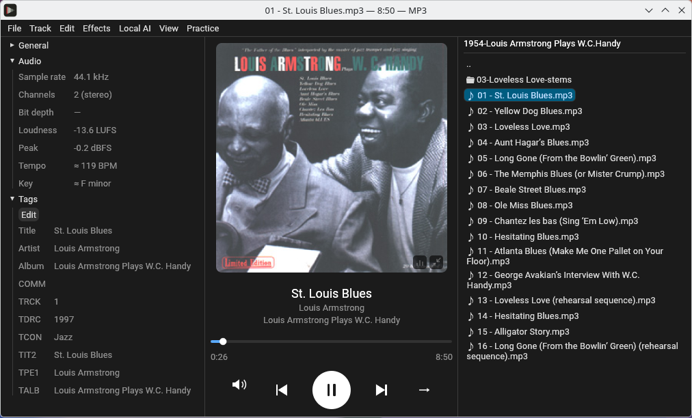
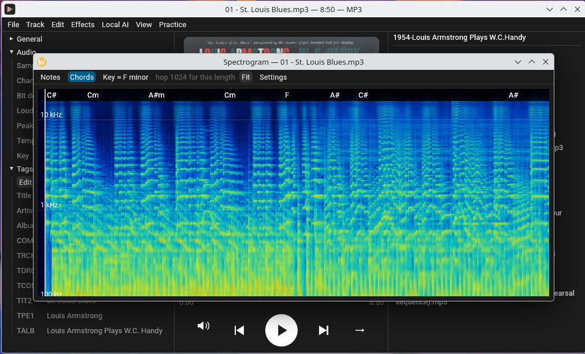

<p align="center">
  
</p>

<p align="center">
  <strong>Opening a song shouldn't feel like a loading screen.<br>
  Trimming it shouldn't take a second app.</strong>
</p>

# soundglass

A small, fast music player and quick editor for Linux and Windows, written in Rust. Open a file and
hear it at once, move through a folder without waiting, and make quick fixes without risking your
originals: edits are only ever written to a copy, when you choose to save one. It collects nothing:
no telemetry, no account, and it never goes online on its own.



## Status

soundglass is **in development**. The player (v1) is usable on Linux and Windows: playing,
browsing a folder, quick edits and effects, speed and pitch, tags and the local AI tools. Practice
mode (v2), the tools for musicians, is in progress. [`PRODUCT_BRIEF.md`](docs/PRODUCT_BRIEF.md)
has the plan.

## Main features

- **Sound at once.** Playback starts before the file is fully decoded, and Page Up / Page Down move
  through the folder; the Folder panel browses the rest.
- **Your originals stay safe.** Cut, crop, silence, fades, gain, normalize, trim silence and
  reverse, with full undo and redo; Save Copy and Save As write a new file. Deleting moves a file to
  the Trash, and Ctrl+Z brings it back.
- **Speed and pitch.** Slower or faster at the same pitch, or higher or lower at the same speed,
  live while it plays.
- **Tags and names.** Edit tags and covers, give a whole folder its cover, rename files from their
  tags, and look a track or a whole album up on AcoustID and MusicBrainz, or a track by name on Wikipedia,
  Discogs or MusicBrainz (only when you ask).
- **Practice mode.** A spectrogram with note lines and chords, loops, tempo and key estimates, and
  a metronome on the beats.
- **Local AI tools.** Remove noise, split a song into stems, turn a melody into MIDI, find the beats
  and transcribe speech, all on your own computer and offline. Nothing is installed until you ask
  for it ([AI tools](#ai-tools)).
- **Private by design.** No telemetry, no account, and it never goes online on its own.
- **Your keys, your colours.** Every menu item can get its own keyboard shortcut, the font size is
  adjustable, and themes (including high contrast) are plain XML files.

Every feature, and the supported formats, are described in [`FEATURES.md`](docs/FEATURES.md).

## Screenshots

The Spectrogram in Practice mode, with note lines and chords:



## Installation

soundglass runs on Linux, on both Wayland and X11. It has been developed and tested on Kubuntu with
KDE Plasma; the Windows build is made and tested on GitHub Actions. Each release on GitHub has a Linux package and a Windows installer. Both
install only the program, its menu entry and its icon; settings, themes and AI models live in the
data folder (`~/.local/share/soundglass/`, `%APPDATA%\soundglass\data\`), so removing the package
keeps them.

### Ubuntu 22.04, Debian 12 or newer (64-bit Intel/AMD)

1. Download the `.deb` file from the [Releases](../../releases) page.
2. Install it: `sudo apt install ./soundglass_0.1.0_amd64.deb`, or double-click it.
3. Open soundglass from your applications menu. The first time, it offers to become your default
   player (File → Settings… → Make soundglass the default player does it later).

To uninstall, run `sudo apt remove soundglass`.

### Windows 10 or 11 (64-bit)

Download `soundglass-0.1.0-x64.msi` from the [Releases](../../releases) page and run it. The
installer isn't signed, so Windows may warn about it first: choose More info → Run anyway. Then
choose soundglass in Settings → Default apps (Windows doesn't let an installer make itself the
default).

### From source (any other distribution)

You need a [Rust toolchain](https://rustup.rs) and the ALSA headers (`sudo apt install
libasound2-dev` on Debian/Ubuntu). From a checkout of this repository:

```sh
./install.sh
```

This builds soundglass, copies it to `~/.local/bin`, adds `soundglass.desktop` to
`~/.local/share/applications`, and **makes it the default** for MP3, FLAC, WAV, Ogg Vorbis,
M4A/AAC, AIFF, CAF and Matroska audio. Opus is not supported yet.

To undo it, delete `~/.local/bin/soundglass`, `~/.local/share/applications/soundglass.desktop` and
`~/.local/share/icons/hicolor/scalable/apps/soundglass.svg`, then pick another default app in System
Settings → Default Applications (or File Associations).

To build without installing:

```sh
cargo build --release
```

## Usage

```sh
soundglass              # open an empty window
soundglass song.mp3     # play a file
```

[`MENUS.md`](docs/MENUS.md) lists every menu item and shortcut.

Settings are saved in `~/.local/share/soundglass/app.ron` (Windows: `%APPDATA%\soundglass\data\`).

## AI tools

Everything runs on your own computer, on the CPU or a GPU. Your audio is never uploaded: soundglass
only goes online to download the runtime and models you ask for, and after that the AI tools work
offline.

The AI tools are in the Local AI menu. They need ONNX Runtime, installed with Local AI → Download AI
Runtime…, and the model for the task, from Local AI → AI Models…. Each download is pinned by
SHA-256 and starts only after you accept its licence. Models live in
`~/.local/share/soundglass/models`.

The tools work on the selection in the Edit panel, or on the whole track, and write a new file next
to it:

- **Remove Noise** (DeepFilterNet3, 16 MB): cleans background noise from speech.
- **Split into Stems** (HTDemucs v4, 166 MB): drums, bass, other and vocals, each in its own file.
- **Melody to MIDI** (Spotify's Basic Pitch, 0.2 MB): what's played or sung, as a MIDI file.
- **Find Beats** (Beat This!, 191 MB): the beats and bars, for the Spectrogram and the Metronome.
- **Transcribe Speech** (Parakeet TDT 0.6B v3, Whisper small or Whisper large-v3-turbo): the words,
  as text or subtitles.

GPU support is optional, and AI Models… offers two downloads:

- **NVIDIA** (CUDA, about 1.5 GB): makes Split into Stems and Find Beats 2.6–3× faster on a GTX
  1050.
- **AMD, Intel and others** (WebGPU, about 6 MB on Linux and 13 MB on Windows; experimental): any
  graphics card with Vulkan (Linux, needs `libvulkan1`) or Direct3D 12 (Windows). Only Find Beats
  uses it. A weak built-in chip can be slower than the CPU, so switch Use the GPU off if it doesn't
  help. With both installed, NVIDIA's is used.

If the GPU can't be used, soundglass falls back to the CPU and shows why. Each tool's settings,
speed and output are in [`FEATURES.md`](docs/FEATURES.md#ai-tools).

## Development

```sh
cargo test                           # run the tests
cargo run --release -- song.mp3
soundglass --timings song.mp3        # print the time to the window and to the first sound
soundglass --bench song.mp3          # the same, quitting at the first sound
```

`./package-deb.sh` builds the .deb locally; the .msi is built on GitHub Actions
(`.github/workflows/build.yml`).

Documents:

- [`FEATURES.md`](docs/FEATURES.md): every feature, and the supported formats
- [`MENUS.md`](docs/MENUS.md): every menu item and shortcut
- [`PRODUCT_BRIEF.md`](docs/PRODUCT_BRIEF.md): goals, scope and milestones
- [`DECISIONS.md`](docs/DECISIONS.md): the decision log
- [`TIME_STRETCH.md`](docs/TIME_STRETCH.md): the study behind speed and pitch
- [`BEAT_TRACKING.md`](docs/BEAT_TRACKING.md): the first beat tracker, results and ideas
- [`CHORDS.md`](docs/CHORDS.md): the first chord recogniser, results and ideas
- [`TRANSLATING.md`](docs/TRANSLATING.md): how to add a language

### Making a release

1. Raise `version` in `Cargo.toml` and run `cargo build` so `Cargo.lock` follows.
2. Add a `<release version="…" date="…"/>` line at the top of `soundglass.metainfo.xml`'s releases.
3. Commit.
4. Tag it `vX.Y.Z` (the same version) and push the tag: the workflow checks the tag matches
   `Cargo.toml`, runs the tests and `cargo audit`, builds both packages and publishes the release.
5. Check the release page has the .deb and the .msi. If only the Windows job failed, "Re-run failed
   jobs" adds the .msi later.

## Contributing

soundglass is still growing, along the plan in [`PRODUCT_BRIEF.md`](docs/PRODUCT_BRIEF.md). What
helps most:

- **Bug reports.** Open an issue with the steps to reproduce it, the file type and your system
  (Linux distribution and desktop, or Windows version). Bug fixes are welcome as pull requests.
- **Translations.** See [`TRANSLATING.md`](docs/TRANSLATING.md).

**Feature ideas** are welcome too, but please open an issue to discuss one before writing code for
it: soundglass means to stay small, so a pull request that adds a feature may be declined, however
well it's made.

## Licence

soundglass is free software: you can redistribute it and/or modify it under the terms of the
[GNU General Public License](LICENSE), version 3 or later. It comes with no warranty.

Bundled libraries, built from source into the program: LAME (MP3 encoding, LGPL), libvorbis with
the aoTuV and Lancer patches and libogg (Ogg Vorbis encoding, BSD-3-Clause). The fonts are Apache-2.0
and MIT licensed; see [`fonts/NOTICE.txt`](fonts/NOTICE.txt). `third-party-notices.py` gathers the
licences of the fonts and of every Rust crate and bundled library; the packages carry its output
(`/usr/share/doc/soundglass/copyright`, `LICENSES.txt` on Windows). All are GPL-3-compatible.

The AI runtime and models are not part of soundglass: each is downloaded only on request, after its
licence (embedded in [`licenses/`](licenses)) is shown and accepted. Speech recognition with
Parakeet uses NVIDIA's Parakeet TDT 0.6B v3, licensed under CC BY 4.0
(https://huggingface.co/nvidia/parakeet-tdt-0.6b-v3), in istupakov's ONNX conversion, unchanged.
