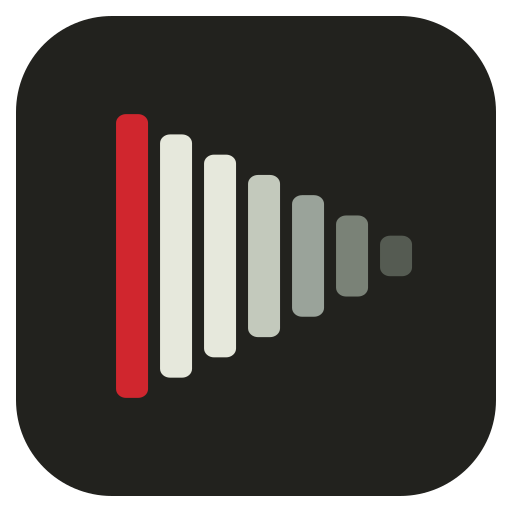

<p align="center">
  
</p>

# soundglass

A small, fast audio player for Linux, written in Rust. Open a file and hear it at once. See [PRODUCT_BRIEF.md](PRODUCT_BRIEF.md) for where it is heading.

## Build and run

Needs Rust and the ALSA headers (`sudo apt install libasound2-dev` on Debian/Ubuntu).

```
cargo run --release -- song.mp3
```

Without a file it asks for one. `--timings` prints the time to the window and to the first sound; `--bench` exits at the first sound.

## Keys

- Space: play/pause
- Left / Right: back or forward 5 s
- Page Up / Page Down: previous or next file in the folder
- Ctrl+I: show or hide Track Info (on the left); Ctrl+B: show or hide the Folder panel (on the right), which lists `..`, the subfolders and the audio files by name: click a folder to look inside it (playback carries on), click a file to play it. Each panel widens the window instead of squeezing the player
- Ctrl+E: show or hide the Edit panel
- In the Edit panel: click to play from there, drag to select, Shift+click or Shift+drag to change the selection, scroll to zoom, right-drag (or scroll sideways) to move along
- View → Practice mode (off by default) adds a Practice menu with the tools for musicians — Loop selection (L), the Spectrogram — and the tempo, key and chord estimates; with it off none of them is shown or worked out
- Practice → Spectrogram opens it in its own window (log frequency, 20 Hz up): click to play from there, drag to select (the same selection as the Edit panel, so Loop works on it), scroll to zoom, Ctrl+scroll to zoom the frequencies, right-drag to move around in both directions; Fit shows everything again. Space, L, Esc, ←/→ and PageUp/Down work there too
- On the Spectrogram's toolbar, Chords shows a bar along the top with the chords (major, minor and 7ths) against the track's time; they follow the edits and the zoom, and are named like the note lines. It's a first try: it finds the main chords better than when they change (docs/CHORDS.md). Key ≈ … (once estimated) shows the detected key's scale (a minor key as its relative major). Notes shows lines at the notes' pitches (C thicker), named where they fit; Settings sets the tuning (A4), C D E or Do Ré Mi, sharps or flats, octave numbers, the scale shown (all notes or one of the 12 major scales, spelled as the key spells them), an instrument's range in concert pitch (trumpet E3–Bb5, tenor sax Ab2–Eb5), and the lines' look (colours for the tonic — C with all notes, the key's tonic with a scale — and the other lines, tonic width, label size). The spectrogram is worked out once per file (and again after an edit or an Analysis change), so zooming and panning are instant. Its Analysis part sets the FFT size, window size, hop (256, 512 or 1024 samples; raised for long files, sooner with big FFTs) — every FFT bin is kept and drawn, the window function, the level range, the lowest frequency and the colours, with Reset to defaults. All are remembered.
- Esc: clear the selection
- Delete: cut out the selection; Ctrl+T: crop to it; Ctrl+L: replace it with silence
- Ctrl+Z: undo; Ctrl+Shift+Z or Ctrl+Y: redo
- L (Practice mode): loop the selection on or off (otherwise playback stops at its end)
- Ctrl+S: Save Copy — the edits next to the original, in its format, as `name-edited` (then `name-edited-2`…)
- Ctrl+Shift+S: Save As (the original file is never changed), with the format, quality and sample rate, and whether to apply the speed and pitch
- Ctrl+O: open a file
- Ctrl+Q: quit

## Effects

The Effects menu works on the selection, or on the whole track when nothing is selected. Each item has presets and a Custom… value, and every effect can be undone:

- Fade in, Fade out: over the whole selection, or 1, 3 or 5 s from its start or end; the loudness changes evenly to the ear
- Gain: up or down by a number of dB
- Normalize: the peak near or at the maximum (−1 or 0 dBFS), or the loudness as streaming (−14 LUFS), as podcasts (−16) or as TV (−23)
- Trim silence: removes what is quieter than a level at the start and end
- Reverse: plays it backwards
- Channels: mono, stereo or swap left and right (always the whole track)

## Speed and pitch

The Playback menu changes how it plays, live, and the settings combine:

- Change speed and pitch: faster is also higher, like tape (0.5× to 2×)
- Pitch-preserved speed change: slower or faster at the same pitch (0.5× to 2×)
- Time-preserved pitch change: up or down by semitones at the same speed (−2 to +2, Custom… up to ±12 in steps of 0.1)

Reset puts all three back to normal. The last two use WSOLA, which can sound a little echoey or stuttery on dense mixes. Save As can apply them to the file.

## Tags and names

- In Practice mode, Track Info shows the estimated tempo and key (Audio, after loading; the first 10 minutes are analysed). Tempo is counted as people tap along, so it can be an octave off.
- In Track Info, Edit (in Tags) changes the title, artist, album, year, track, genre, BPM, key and cover; the estimate buttons (Practice mode) fill BPM and Key, and ½× / 2× halve or double the BPM. Save… asks first, then writes the tags into the file; the audio is checked unchanged before the file is replaced. Save As and Save Copy also take tag edits not yet saved.
- File → Identify Track… (online, only when you click Look up) sends the file's Chromaprint fingerprint and length to AcoustID and lists the matches with their score; Use Match fetches the genre from MusicBrainz (sending only the recording's ID) and fills Track Info's tag editor, only the empty fields unless you untick that. Nothing is written until Save… there. It is greyed out until the build has an AcoustID key and a contact URL (`src/identify.rs`).
- File → Rename from Tags… renames the current file from a pattern such as `{track} - {artist} - {title}` (also `{album}`, `{year}`, `{genre}`), with a preview. A missing tag is left out, and an existing file is never replaced.

## Themes

File → Settings… → Theme changes the colours and shapes of menus, panels, dialogs and buttons. The seek bar, the waveforms and the play buttons use the theme's colours too. A theme can't move, add or hide anything, and it doesn't change the fonts or the Spectrogram's colours (those are in its own settings).

- **Theme files:** each theme is an `.xml` file in `~/.local/share/soundglass/themes` (Windows: `%APPDATA%\soundglass\data\themes`), which the Open themes folder button opens. The first time soundglass starts, it writes `dark.xml`, `light.xml` and `high-contrast.xml` there. Edit them, or copy one under a new name to make your own; a file's name is its name in the list. soundglass never overwrites or recreates these files, so edits and deletions stay. lightview's theme files work here too.
- **Choosing a theme again** reloads its file, so you can edit it and look at the result without restarting.
- **Follow system** (the default) uses `dark.xml` or `light.xml`, depending on the desktop's dark/light setting. On Linux it's read when soundglass starts, so after changing the desktop's setting, restart soundglass. When the desktop gives no preference, `dark.xml` is used.
- **The base theme:** built into soundglass and identical to the original Light theme. Any key a file leaves out takes the base theme's value. A file that's missing or can't be read (bad XML, a wrong value, bigger than 64 KiB) is replaced by the whole base theme, and Settings says what's wrong and on which line.

The three files set every key, so they work as templates. `mode` is `dark` or `light`: it decides which half of Follow system the theme can stand in for, and the shades of things themes don't set, such as shadows. Colours are `#rrggbb` or `#rrggbbaa`.

```xml
<theme mode="dark">  <!-- or "light" -->
  <colors panel="#1b1b1b" window="#1b1b1b" border="#3c3c3c" field="#0a0a0a" text="#8c8c8c"
          accent="#005c80" selected-text="#c0deff" hyperlink="#5aaaff" warn="#ff8f00" error="#ff0000"
          played="#5aaaff"/>
  <widget state="hovered" fill="#404040" text="#f5f5f5" border="#969696"/>
  <!-- … one widget element for each of the five states … -->
  <shape rounding="6" stroke="1" spacing="8,3" padding="4,1"/>
</theme>
```

- `colors`: `panel` and `window` are the background of the menu bar and panels, and of dialogs and menus; `border` is the border of dialogs and menus; `field` is the background of text fields; `text` is labels and other text; `accent` and `selected-text` are selected items and their text; `hyperlink`, `warn` and `error` are links, warnings and errors; `played` is the played part of the seek bar and the waveforms (left out, it's the file's own `accent`, not the base theme's, so lightview's themes still look as they did there).
- `widget`: `state` is `noninteractive` (separators, frames), `inactive`, `hovered`, `active` (pressed) or `open` (an open menu or list), one element per state; `fill`, `text` and `border` are that state's background, text and border.
- `shape`: `rounding` is the corner radius of buttons, menus and dialogs, 0–16; `stroke` is the border width, 0.5–4 (set a `border` colour for `inactive` too, or its border stays invisible); `spacing` and `padding` are the space between items and inside buttons, `x,y`, each 0–24.

Unknown elements and attributes are ignored.

## Local AI

Nothing AI is shipped. Local AI → Download AI Runtime… installs ONNX Runtime 1.31.1 (11 MB on Linux, 83 MB on Windows) into the data folder's `lib/`, and AI Models… downloads the models into `models/`. Each download shows its licence first, is pinned by SHA-256 (a file that doesn't match is deleted) and is only made when you click. With an NVIDIA driver, AI Models… also offers GPU support: ONNX Runtime's CUDA 12 build and NVIDIA's libraries (about 1.5 GB, into `gpu/`); it takes effect after a restart. On a GTX 1050 it makes Split into Stems and Find Beats 2.6–3× faster; the other tools stay on the CPU, where they run faster.

The tools work on the track as edited and never change it: each writes a new file next to it and opens it. Each installed model has a few settings in AI Models (Settings: …), kept per model, with Reset to defaults: Remove Noise's strength (full, or at most 6–60 dB less noise), Split into Stems' overlap and which stems to write, Melody to MIDI's onset and note thresholds, shortest note, note range, held notes and the file's tempo, Find Beats' sensitivity, and for Transcribe Speech the level under which quiet parts are skipped, plus Whisper's language (a code such as en or es, empty to detect it), Translate to English, and Time marks (on by default), which gives the transcript as subtitles (.srt) to save with Save as Subtitles…: Parakeet times them from its words (cues end at a sentence end, a pause over 1 s, 7 s or 84 characters), Whisper small with its own segments; large-v3-turbo gives no times of its own, so its cues are whole pieces of up to 29 s.

- **Remove Noise** (DeepFilterNet3, 16 MB): cleans background noise from speech and writes `name-denoised.flac` at the track's sample rate. Made for voices; on music it can take away more than noise. On a 12-thread CPU it runs about 2.4× faster than real time for a stereo track.
- **Split into Stems** (HTDemucs v4, 166 MB): writes `drums.flac`, `bass.flac`, `other.flac` and `vocals.flac` into a new `name-stems` folder and opens the vocals, so Page Down and the Folder panel step through the others. About real time on the CPU (a 4-minute song takes about 5 minutes); much faster with GPU support. All four stems are held in memory, about 170 MB a minute of audio.
- **Melody to MIDI** (Spotify's Basic Pitch, 0.2 MB): turns what's played or sung, several notes at once, into `name-melody.mid` (120 bpm, Electric Piano), with Basic Pitch's default thresholds and no pitch bends. A minute of audio takes about a second.
- **Find Beats** (Beat This!, 191 MB): finds the beats and the first beat of each bar, shown as ticks along the bottom of the Spectrogram; then the volume button's popup turns on the Metronome, which clicks on them while the track plays (louder on the first of each bar), with its own Clicks slider, through cuts, reversals and speed changes. Practice → Metronome is the same switch. A song takes 10–30 s on the CPU. Speech and free-time passages get no beats.
- **Transcribe Speech** (three models; pick one in AI Models…): shows the track's words in a window, with Copy and Save as Text…. Long recordings are cut into pieces of at most 29 s at quiet moments; silent pieces are skipped. On a 12-thread CPU, for 164 s of a 1954 interview:
  - Parakeet TDT 0.6B v3 (671 MB): 25 European languages, punctuated, the most accurate and fastest, 14 s. CC BY 4.0: by NVIDIA.
  - Whisper small (375 MB): 99 languages, detected from the first piece with sound, 88 s.
  - Whisper large-v3-turbo (1,037 MB): 99 languages, about as slow as small on the CPU; it may leave out capitals and punctuation.

## Install as the default audio player

```
./install.sh
```

This builds soundglass, copies it to `~/.local/bin`, adds `soundglass.desktop` to `~/.local/share/applications`, and makes it the default for MP3, FLAC, WAV, Ogg Vorbis, M4A/AAC, AIFF, CAF and Matroska audio. Opus is not supported yet.

To undo: delete `~/.local/bin/soundglass`, `~/.local/share/applications/soundglass.desktop` and `~/.local/share/icons/hicolor/scalable/apps/soundglass.svg`, then pick another default app in System Settings → Default Applications (or File Associations).

## Licence

GPL-3.0-or-later.

Bundled libraries, built from source into the program: LAME (MP3 encoding, LGPL), libvorbis with the aoTuV and Lancer patches and libogg (Ogg Vorbis encoding, BSD-3-Clause). The Rust crates' licences are in `Cargo.lock`'s dependency list; all are GPL-3-compatible.

The AI runtime and models are not part of soundglass: each is downloaded only on request, after its licence (embedded in `licenses/`) is shown and accepted. Speech recognition with Parakeet uses NVIDIA's Parakeet TDT 0.6B v3, licensed under CC BY 4.0 (https://huggingface.co/nvidia/parakeet-tdt-0.6b-v3), in istupakov's ONNX conversion, unchanged.
